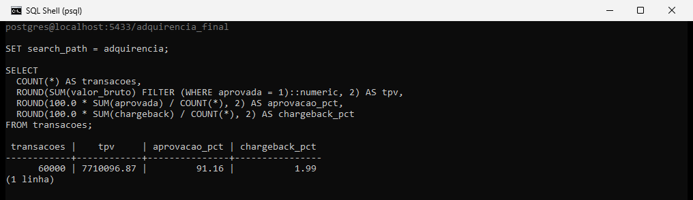
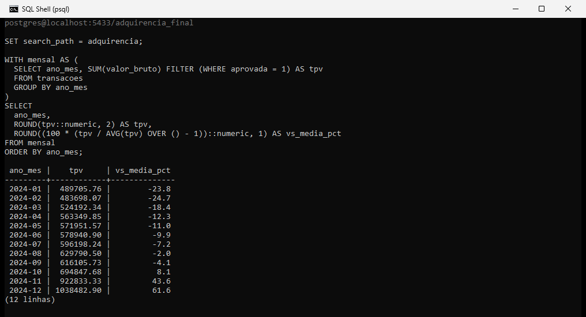

# Panorama de Pagamentos — Adquirência 2024

Projeto de portfólio para transição de carreira para Análise de Dados. Setor: **meios de pagamento (adquirência/maquininha)**. Ciclo completo: modelagem SQL, limpeza, análise e dashboard executivo em Power BI.

Passo a passo de como o dashboard foi montado (modelo, medidas DAX, gráficos): [`documentos/GUIA_POWER_BI.md`](documentos/GUIA_POWER_BI.md). Documentação completa do projeto: [`documentos/DOCUMENTACAO_PROJETO.md`](documentos/DOCUMENTACAO_PROJETO.md).

---

## A base

Base sintética (mas calibrada com padrões reais de mercado de adquirência) de uma operadora fictícia de maquininhas de cartão em 2024: 3.000 lojistas cadastrados, 3.990 maquininhas ativadas e 60.000 transações processadas, cobrindo as 19 UFs mais representativas do país. Cada transação carrega bandeira, modalidade (débito, crédito à vista, crédito parcelado), taxa de MDR aplicada, status (aprovada, negada ou chargeback) e, quando aprovada, se houve antecipação de recebíveis.

Os números a seguir vieram de execução real de SQL contra essa base, não são estimativa: 60.000 transações, 54.693 aprovadas, 4.114 negadas e 1.193 chargebacks. Taxa de aprovação de 91,16% e chargeback rate de 1,99%, calculado sobre todas as transações (1.193 de 60.000), incluindo as negadas. Sobre as aprovadas mais os chargebacks seria 2,13%. TPV (volume total processado) de R$ 7.710.096,87, com ticket médio de R$ 140,97. Receita de MDR de R$ 203.760,95, equivalente a uma taxa média blended de 2,64% sobre o volume.

Dos 3.000 lojistas cadastrados, só 2.145 têm alguma transação em 2024; os outros 855 nunca transacionaram. Por isso a coluna `lojistas` do bloco 10 soma 2.145 e não 3.000. Nas transações negadas e nos chargebacks, `valor_taxa` e `valor_liquido` são zero, então `valor_bruto - valor_taxa` não fecha com `valor_liquido` nessas linhas (nas aprovadas fecha sempre). É assim que o dado foi gerado; para somar `valor_liquido` é preciso filtrar `status = 'Aprovada'`.

---

## Como o projeto foi montado

A base foi gerada em Python (`00_gerar_base.py`, com semente 42), com distribuições calibradas para reproduzir padrões reais de adquirência: MDR menor no débito e maior no crédito parcelado, taxa de aprovação em torno de 91%, chargeback rate abaixo de 2%, e sazonalidade de volume puxada por Black Friday e Natal em novembro e dezembro. Rodei o gerador do zero com numpy 2.5.4 e pandas 3.1.0 e os três CSV saíram idênticos aos de `03_dados/` (conferi por hash SHA-256), então o script reproduz a base publicada. Ele leva alguns minutos.

A modelagem, limpeza e análise rodaram em PostgreSQL, num schema próprio (`adquirencia`). O pipeline usa CTE, window functions (`RANK` para ranquear lojistas por volume e `LAG` para calcular o crescimento mês a mês) e `PERCENTILE_CONT` para medir a distribuição de ticket por segmento de lojista. Os 10 blocos de análise estão em `02_sql/04_analises.sql`, seguidos de uma consulta extra (bloco 11) que compara dezembro com a média mensal.

Indicadores gerais da operação (transações, TPV, aprovação e chargeback):



TPV mensal contra a média do ano, com window function. Dezembro fica 61,6% acima:



O dashboard final foi montado no Power BI, com modelo semântico próprio, medidas DAX e visuais nativos (cartão, linha, rosca, barras e colunas com eixo duplo). O passo a passo completo, incluindo o prompt da imagem de fundo usada como base do layout, está em `documentos/GUIA_POWER_BI.md`.

---

## Estrutura do repositório

```
projeto-adquirencia-pagamentos/
├── README.md
├── requirements.txt                  # numpy e pandas, só para o gerador
├── 00_gerar_base.py                  # gerador da base sintética (semente 42)
├── 02_sql/
│   ├── 01_criar_tabelas.sql          # DDL + índices + constraints
│   ├── 02_carregar_dados.sql         # COPY dos CSV
│   ├── 03_limpeza.sql                # checagens + colunas derivadas
│   └── 04_analises.sql               # 10 KPIs com CTE/RANK/LAG/PERCENTILE_CONT + dezembro x média
├── 03_dados/
│   ├── lojistas.csv                  # 3.000 lojistas cadastrados
│   ├── maquininhas.csv               # 3.990 maquininhas ativadas
│   └── transacoes.csv                # 60.000 transações em 2024
├── documentos/
│   ├── DOCUMENTACAO_PROJETO.md       # documentação completa do projeto (conceitos, dataset, checklist)
│   ├── GUIA_POWER_BI.md              # passo a passo do dashboard: modelo, medidas DAX, gráficos
│   └── 05_post_linkedin.md           # texto do post
└── 06_prints/                        # imagens do projeto
    ├── fluxograma_ferramentas.png    # pipeline de ferramentas (Python → PostgreSQL → Power BI → GitHub)
    ├── capa_linkedin.png             # capa com os KPIs principais
    ├── fundo_dashboard_powerbi.png   # imagem de fundo usada no layout do dashboard
    ├── print_dashboard_final.png     # dashboard Power BI completo
    ├── print_sql_modalidade_mdr.png       # print real do SQL — modalidade x MDR x ticket médio
    ├── print_sql_percentis_segmento.png   # print real do SQL — percentis de ticket por segmento (PERCENTILE_CONT)
    ├── print_sql_kpis_gerais.png          # print real do SQL — transações, TPV, aprovação e chargeback
    └── print_sql_tpv_mensal_vs_media.png  # print real do SQL — TPV mensal contra a média (window function)
```

---

## O que o dashboard mostra

O bloco de topo traz os cinco números que resumem a operação: TPV, ticket médio, taxa de aprovação, chargeback rate e receita de MDR. A evolução mensal mostra o TPV crescendo de R$ 489.705,76 em janeiro para R$ 1.038.482,90 em dezembro, com salto de 32,81% em novembro (Black Friday) puxando o pico do ano. Dezembro processa 61,6% a mais que a média mensal, medido pelo TPV (R$ 1.038.482,90 contra uma média de R$ 642.508,07); contando transações em vez de volume, a diferença seria de 63,2%. A conta está no bloco 11 de `02_sql/04_analises.sql`. Por bandeira, Visa lidera com 38,05% do TPV, seguida por Mastercard (34,62%) e Elo (18,27%). Por modalidade, o crédito parcelado carrega o MDR mais alto (4,34% médio) contra 1,35% do débito, o que também explica por que ele responde por uma fatia desproporcional da receita de MDR mesmo movimentando menos volume que o débito. O ranking de lojistas mostra concentração: os 15 maiores TPVs somados já respondem por cerca de 8,6% de todo o volume processado, todos lojistas de porte Grande.

---

## Como reproduzir

Precisa de PostgreSQL 14+ (testei na 16) e do `psql`. Os comandos abaixo foram rodados em Git Bash, a partir da raiz do repositório. O `\copy` do script 02 usa caminho relativo (`03_dados/...`), então os scripts precisam ser executados dessa pasta, e não de dentro de `02_sql/`. No Windows, sem `PGCLIENTENCODING=UTF8` o `psql` pode ler os CSV como WIN1252 e dar erro de byte inválido ou acento trocado.

```
export PGCLIENTENCODING=UTF8
psql -U postgres -c "CREATE DATABASE adquirencia_db ENCODING 'UTF8'"
psql -U postgres -d adquirencia_db -v ON_ERROR_STOP=1 -f 02_sql/01_criar_tabelas.sql
psql -U postgres -d adquirencia_db -v ON_ERROR_STOP=1 -f 02_sql/02_carregar_dados.sql
psql -U postgres -d adquirencia_db -v ON_ERROR_STOP=1 -f 02_sql/03_limpeza.sql
psql -U postgres -d adquirencia_db -v ON_ERROR_STOP=1 -f 02_sql/04_analises.sql
```

O banco precisa existir antes do script 01, que cria o schema `adquirencia`. O script 02 não pode ser executado duas vezes: a segunda carga falha por chave duplicada. Para recarregar, rode o 01 de novo, que apaga e recria o schema, e depois o 02. Ao final do 04, o TPV deve dar R$ 7.710.096,87 e a taxa de aprovação 91,16%.

Para gerar os CSV de novo, instale as dependências com `pip install -r requirements.txt` e rode `python 00_gerar_base.py`, que grava em `03_dados/` (ou na pasta passada como argumento). Para o dashboard, siga `documentos/GUIA_POWER_BI.md` e monte o modelo no Power BI Desktop.

---

## Autor

**Vitor França** — engcivil.vitorfranca@gmail.com
Em transição para Análise de Dados.
